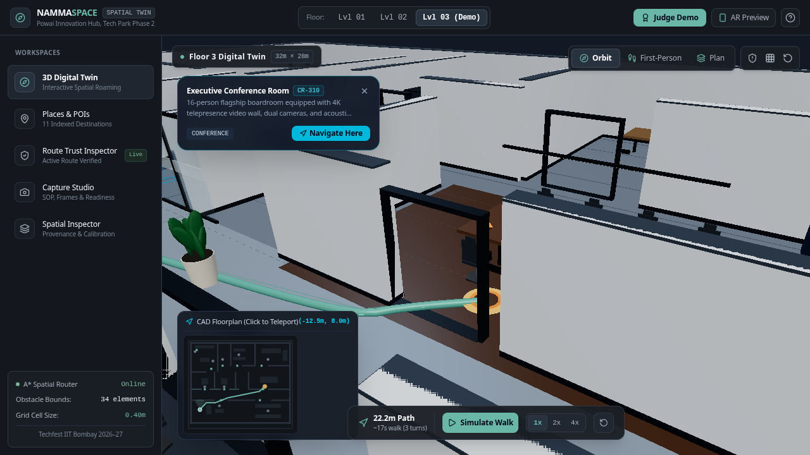
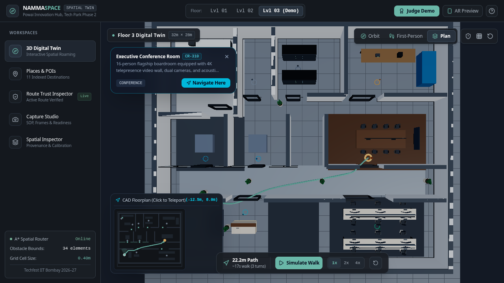
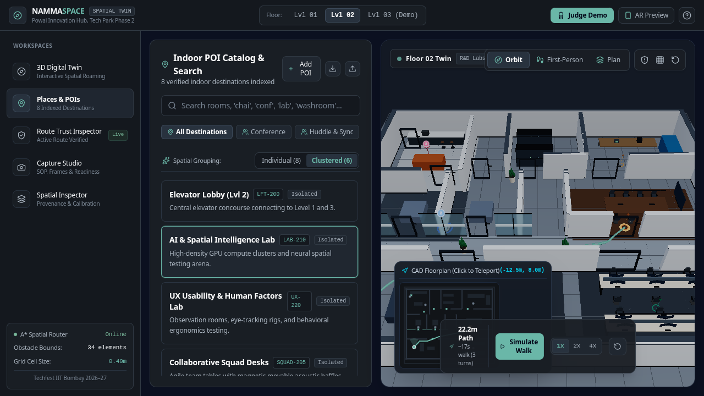
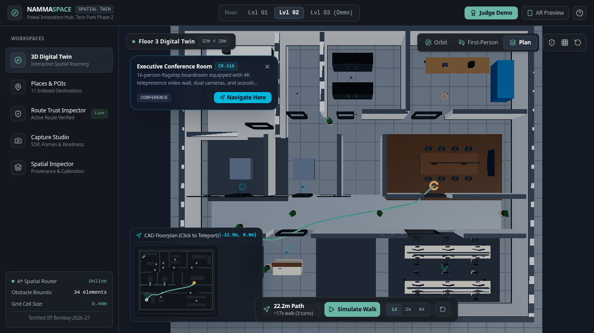
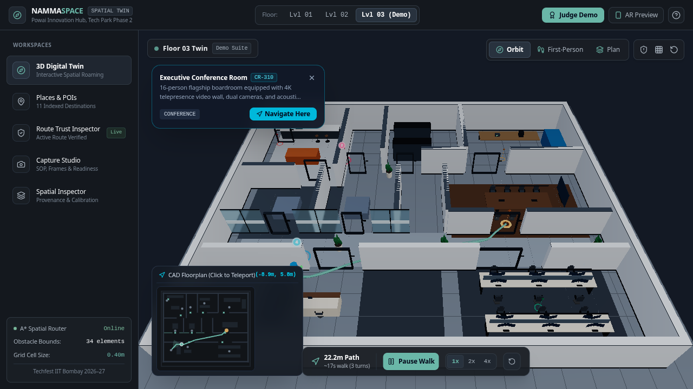

# GeoNexus – Namma Space
### Intelligent 3D Indoor Digital Twin, Spatial Navigation & POI Discovery Engine
**Techfest 2026–27 | IIT Bombay | Team GeoNexus (TM-912137DB2BC)**

---

## 1. Project Overview

**GeoNexus – Namma Space** is a browser-native, zero-install 3D indoor digital twin and spatial intelligence platform engineered for complex corporate campuses, university facilities, and research complexes. Developed for the **Namma Space** challenge at **Techfest 2026–27, IIT Bombay**, the platform transforms raw indoor smartphone captures into interactive, photometrically credible 3D virtual environments.

The system combines human-scale 3D WebGL rendering, free-roaming exploration, automated POI spatial clustering, obstacle-aware $A^*$ pathfinding, and mathematical route trust verification.

---

## 2. Problem Statement

Outdoor navigation is ubiquitous due to GPS and satellite positioning. However, indoor facilities remain predominantly unmapped, dark zones:
- **GPS Ineffectiveness:** Satellite signals are attenuated and blocked by concrete floors, steel columns, and coated glass facades.
- **Topological Complexity:** Facilities span multiple vertical levels connected by lifts, stairs, and narrow corridors with dynamic obstacles.
- **Cost Barrier:** Traditional industrial spatial scanning requires specialized LiDAR rigs (Matterport Pro3, Leica BLK360) costing upwards of $5,000–$25,000.
- **High Consequence of Error:** A 1-meter localization error indoors places an agent inside a structural wall or restricted laboratory.

**Namma Space** addresses this challenge by enabling low-cost smartphone video capture to be ingested into verifiable, interactive 3D digital twins with sub-meter path planning.

---

## 3. Main Features

- **Zero-Install WebGL 3D Viewer:** High-performance Three.js rendering engine with physically based materials (PBR gallery plaster, frosted glass partitions, smoked walnut, biophilic planters).
- **First-Person Free Roaming (Eye Level $1.65\text{m}$):** Desktop `W`/`A`/`S`/`D` navigation with pointer-lock mouse look and 2D axis-aligned sliding bounding-box collision clearance against 34 architectural obstacles.
- **Autonomous Independent Roaming:** Free roaming functions 100% standalone with zero active navigation or route calculation required.
- **Dynamic POI Visual Clustering:** Agglomerative spatial clustering engine that automatically groups proximate destination pins into unified, count-badged beacons at low zoom distances ($> 22\text{m}$), automatically unfolding into individual pins when zooming in.
- **Interactive Smooth Fly-To:** Clicking any cluster marker initiates a smooth 650ms camera fly-to/dolly-in toward the cluster centroid, seamlessly transitioning from macro to micro inspection.
- **Multi-Floor Transition System:** 480ms cubic ease-out cross-fade transition with elevator vertical sliding between Floor 1 (Ground Atrium & Auditorium), Floor 2 (Collaborative R&D Labs), and Floor 3 (Executive Innovation Suite).
- **Indoor A\* Pathfinder ($0.40\text{m}$ Grid):** 8-directional diagonal pathfinding using Octile distance heuristics, doorway portal carving, and raycast string-pulling path smoothing.
- **Route Trust Inspector:** Mathematical verification panel proving routes maintain a $\ge 0.40\text{m}$ clearance buffer with exactly 0 wall collisions.
- **Semantic POI Search & Synonym Resolution:** Natural language indoor search engine resolving workplace synonyms (e.g., "chai", "coffee", "tea" $\to$ Pantry; "boardroom" $\to$ Executive Conference Room).
- **2D Tactical Minimap:** High-performance direct 30fps canvas rendering pipeline with click-to-teleport and player field-of-view sight cone.
- **Capture Studio:** Client-side video keyframe extractor (HTML5 Video & Canvas API), capture SOP checklist auditor, and quantitative readiness scoring.
- **Binary 3D Model Ingestion:** Real runtime ingestion of external `.glb` and `.gltf` assets via Three.js `GLTFLoader`.
- **Judge Demo Mode:** 10-step automated evaluation tour for competition reviewers.

---

## 4. Technology Stack

| Layer | Technologies |
| :--- | :--- |
| **Frontend Framework** | React 19, TypeScript, Vite 8 |
| **3D Graphics & Shaders** | Three.js (WebGL, PBR, OrbitControls, GLTFLoader) |
| **Styling & Design System**| Tailwind CSS v4, Lucide React Iconography |
| **Mathematical Engines** | Native TypeScript ($A^*$ Pathfinding, Spatial Clustering, Bounding Box Collision) |
| **Testing & Quality** | Node.js Native Test Runner (`node:test`, `node:assert/strict`), Playwright CLI |
| **Runtime & Hosting** | Node.js, Express, Google Cloud Run (Containerized Linux) |

---

## 5. Repository Structure

```text
GeoNexus-Namma-Space/
├── docs/
│   ├── architecture/
│   │   └── ARCHITECTURE.md                  # Detailed modular design and diagrams
│   ├── capture-sop/
│   │   └── INDOOR_CAPTURE_SOP.md            # 8-stage physical venue capture protocol
│   ├── technical-documentation/
│   │   ├── GEONEXUS_NAMMA_SPACE_COMPLETE_PROJECT_DOCUMENTATION.md
│   │   └── NAMMA_SPACE_PROJECT_REPORT.md
│   └── screenshots/                         # Actual production screenshots
│       ├── test_viewer_init.png
│       ├── test_plan_view.png
│       ├── test_floor2_transition.png
│       ├── test_clustered_poi_catalog.png
│       └── test_simulate_walk.png
│
├── public/
│   ├── images/                              # Static hero & plan preview images
│   └── models/                              # Directory for external 3D assets
│
├── scripts/
│   ├── build.sh                             # Production build and type-check runner
│   └── run_tests.sh                         # Automated engine test suite runner
│
├── src/
│   ├── components/
│   │   ├── viewer/                          # Three.js viewport, controls, minimap
│   │   ├── poi/                             # POI catalog & spatial grouping switcher
│   │   ├── inspector/                       # Route Trust & model provenance log
│   │   ├── capture/                         # Video keyframe extractor & SOP checklist
│   │   ├── demo/                            # 10-step judge demonstration tour
│   │   ├── ar/                              # Mobile WebXR visual guidance HUD modal
│   │   └── layout/                          # TopBar and navigation rail
│   │
│   ├── engine/
│   │   ├── pathfinding/                     # A* router & raycast string-pulling
│   │   ├── collision/                       # 2D sliding bounding box clearance
│   │   ├── clustering/                      # Dynamic zoom-distance POI clustering
│   │   └── spatial-index/                   # Semantic POI index & synonym matching
│   │
│   ├── data/                                # Multi-floor environments & CAD blueprints
│   ├── types/                               # TypeScript domain model definitions
│   ├── App.tsx                              # Main application coordinator
│   ├── main.tsx                             # React entrypoint
│   └── index.css                            # Global Tailwind CSS directives
│
├── test/
│   ├── sample-data/                         # Verified CAD coordinates & POI datasets
│   ├── sample-frames/                       # Extracted keyframe manifest samples
│   └── README.md                            # Testing guide and specifications
│
├── .env.example                             # Environment configuration template
├── .gitignore                               # Production ignore patterns
├── index.html                               # HTML5 entrypoint with Google Fonts
├── package.json                             # Dependencies, scripts, and metadata
├── tsconfig.json                            # Strict TypeScript configuration
└── vite.config.ts                           # Vite bundler configuration
```

---

## 6. Installation & Local Development

### Prerequisites
- **Node.js:** v18.0.0 or higher (v20+ recommended)
- **Package Manager:** npm or bun

### Step 1: Clone Repository
```bash
git clone https://github.com/geonexus/namma-space.git
cd namma-space
```

### Step 2: Install Dependencies
```bash
npm install
```

### Step 3: Configure Environment
```bash
cp .env.example .env
```

### Step 4: Run Development Server
```bash
npm run dev
```
The application will be running at `http://localhost:3000`.

---

## 7. Production Build & Deployment

```bash
# Build production bundle with Vite
npm run build

# Run TypeScript static type check
npm run lint

# Preview production build locally
npm run preview
```

---

## 8. Automated Testing

All core mathematical algorithms are decoupled from the browser DOM and verified through the native Node.js test runner:

```bash
# Run all automated unit tests
npm test

# Output summary: 10/10 tests pass across pathfinding, search, and clustering
```

---

## 9. 3D Viewer & Free-Roaming Controls

| Interaction Mode | Controls | Function |
| :--- | :--- | :--- |
| **Orbit Inspection** | Left Click + Drag | Rotate 3D camera around target |
| | Right Click + Drag | Pan camera horizontally / vertically |
| | Scroll Wheel | Zoom camera in / out |
| **Top-Down Plan** | Plan Button (Top-Right) | Orthogonal overhead $y = 32\text{m}$ CAD view |
| **First-Person Roaming** | Click Viewport | Request browser pointer lock |
| | `W` / `ArrowUp` | Walk forward along camera yaw |
| | `S` / `ArrowDown` | Walk backward |
| | `A` / `ArrowLeft` | Strafe left |
| | `D` / `ArrowRight` | Strafe right |
| | `Shift` (Hold) | Sprint multiplier ($6.5\text{ m/s}$) |
| | Mouse Movement | Look horizontally (yaw) and vertically (pitch) |
| | `ESC` | Release pointer lock |
| **Cluster Interaction** | Left Click on Cluster | Smooth 650ms fly-to zoom into cluster centroid |
| **2D Minimap** | Left Click on Minimap | Instantaneous player avatar teleportation |

---

## 10. Indoor Capture SOP Overview

The capture methodology follows an 8-stage protocol designed for standard smartphone cameras:
1. **Eulerian Traversal Planning:** Continuous loop starting and terminating at the same physical anchor.
2. **Camera Constraints:** 4K 60fps recording, locked manual exposure/ISO (100–400), shutter speed $\ge 1/120\text{s}$, and 3-axis gimbal stabilization.
3. **Lighting Control:** Uniform ambient diffuse illumination with blinds closed on glazed perimeter windows.
4. **Physical Scale Calibration:** Two 1.00m optical checkerboard scale bars placed on the corridor floor.
5. **Pace & Overlap:** Heel-to-toe gait at $\le 0.65\text{ m/s}$ maintaining $\ge 70\%$ visual overlap between adjacent frames.
6. **Portal Transitions:** 1.5-second pause at doorway thresholds with $45^\circ$ lateral pans to bridge adjacent zones.
7. **Perimeter Loop Closure:** Exact return to origin to enable loop-closure bundle adjustment.
8. **Client Validation:** Ingest into **Capture Studio** to extract keyframes, measure sharpness, and calculate confidence scores.

*(See full specification in `docs/capture-sop/INDOOR_CAPTURE_SOP.md`)*.

---

## 11. Implementation Status & Honest Technical Disclosures

- **Procedural 3D Digital Twin:** **Fully Implemented.** Generates metric multi-room layouts ($32\text{m} \times 28\text{m}$) across 3 floors.
- **First-Person Free Roaming:** **Fully Implemented.** Works independently without active navigation running.
- **POI Visual Clustering:** **Fully Implemented.** Dynamic camera distance-based grouping and de-clustering.
- **Multi-Floor Transition:** **Fully Implemented.** 480ms cubic ease-out cross-fade with vertical elevator translation.
- **Indoor A\* Pathfinder & Route Trust Inspector:** **Fully Implemented & Tested.** 10/10 unit tests pass.
- **Video Keyframe Extractor:** **Fully Implemented.** HTML5 Canvas client-side extraction with sharpness analysis.
- **Custom Model Ingestion:** **Fully Implemented.** Loads binary `.glb`/`.gltf` 3D assets at runtime.
- **Dense Photogrammetry / 3DGS Execution:** **Disclosed Boundary.** Dense Structure-from-Motion (COLMAP) requires CUDA GPU clusters; the app provides the capture SOP, frame extractor, and pipeline contract interface.
- **Mobile WebXR VPS AR:** **Disclosed Boundary.** Demonstrated via high-fidelity simulated HUD overlay; true markerless 6-DoF relocalization requires native ARCore Geospatial / 8th Wall anchors.

---

## 12. Screenshots

### 3D Digital Twin Viewer & Free Roaming


### Top-Down Orthogonal CAD Plan View


### Dynamic POI Visual Clustering & Spatial Grouping


### Multi-Floor Layer Cross-Fade Transition (Level 02)


### Turn-by-Turn Obstacle-Aware Walk Simulation


---

## 13. Credits & Third-Party Licences

- **Three.js:** MIT License (mrdoob and Three.js authors)
- **React:** MIT License (Meta Platforms, Inc.)
- **Tailwind CSS:** MIT License (Tailwind Labs, Inc.)
- **Lucide React Icons:** ISC License (Lucide Contributors)
- **Vite:** MIT License (Yuxi Evan You and Vite Contributors)

*All core pathfinding, raycast smoothing, collision detection, and spatial clustering algorithms were developed originally by Team GeoNexus for Techfest 2026–27.*

---
**GeoNexus | Techfest 2026–27 | IIT Bombay**
